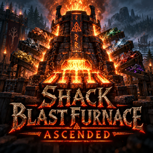

# Shack Blast Furnace Ascended

**[Download on Thunderstore](https://thunderstore.io/c/valheim/p/TheShackDev/Shack_Blast_Furnace_Ascended/)** · version 1.0.0

**The blast furnace smelts copper, tin, scrap iron and silver too, four times as fast as the regular furnace.** In the base game the blast furnace only takes black metal scrap and flametal ore. This mod lets it take the regular furnace's ores as well, and makes it the fast way to smelt them.

## How it works

- The blast furnace takes **copper ore, tin ore, scrap iron and silver ore**, as well as black metal scrap and flametal ore. They come out as the same metal the regular furnace makes.
- Those ores smelt **4× as fast** as in the regular furnace (7.5 s per ore instead of 30 s), for **the same coal per ore**; it just burns it faster.
- **Black metal and flametal don't change**: same speed, same coal as before.
- The blast furnace still holds **10 ore and 20 coal**, all kinds together. Mixed loads are fine: each ore smelts at its own speed, in the order it went in.
- Nothing new to build: no new items, pieces or recipes. The regular furnace doesn't change.
- **OttoFuel** fills the blast furnace from nearby chests like any other furnace, so a blast furnace near your ore chests pulls copper, tin, scrap iron and silver too. **Pull Toggle** (press I on the furnace) turns pulling off for that furnace.
- **MyLittleUI**'s estimated time on the furnace counts the faster speed for the ore that's smelting.

## Settings (`theshack.blastfurnace.cfg`)

Admin-only, and synced from the server:

| Setting | Default | What it does |
|---|---|---|
| Enabled | true | Off: the blast furnace works as in the base game. Ore already in it still finishes. |
| Speed | 4 | How many times faster than the regular furnace it smelts the ores below. 1 = as slow as the regular furnace. |
| Coal per ore | 1 | Coal those ores burn, compared with the regular furnace: 1 = the same, 0.5 = half, 0 = none (it still needs some coal in it to run). |
| Ore capacity | 0 | How much ore the blast furnace holds, all kinds together. 0 = the game's own. |
| Coal capacity | 0 | How much coal it holds. 0 = the game's own. |
| Copper ore, Tin ore, Scrap iron, Silver ore | true | Which of the regular furnace's ores the blast furnace takes. |

## Multiplayer

- **The server and every player need it, at the same minor version.** The game checks what a furnace takes on the PC of the player adding the ore, and smelts on the PC of whoever's game looks after the furnace, so Jotunn turns away anyone without it.
- **Turning it off is safe** (Enabled off, or an ore unticked): ore already in a blast furnace finishes smelting and comes out as metal, and breaking the furnace drops it back out.
- **Removing it, one catch:** let the blast furnaces finish any copper, tin, scrap iron and silver first. Without the mod the blast furnace still burns that ore but gives nothing back.
- If you also use OttoFuel, leave its "BlastFurnaceTakesAll" setting off (The Shack Pack does). This mod decides what the blast furnace takes.

## Building from source

You need the [.NET SDK](https://dotnet.microsoft.com/download) (6.0 or newer) and Valheim. The project compiles against your own copies of the game's DLLs and BepInEx and Jotunn; none of them are in this repo.

```bash
dotnet build -c Release \
  -p:ValheimManaged="/path/to/Valheim/valheim_Data/Managed" \
  -p:ProfileRoot="/path/to/your/profile/BepInEx"
```

`ProfileRoot` is the `BepInEx` folder of any r2modman profile that has Jotunn (it needs `core/` and `plugins/ValheimModding-Jotunn/`). Without the `-p:` options the project looks for a Linux Steam install and an r2modman profile named "The Shack Next". The DLL lands in `bin/Release/`.

This is the source of version 1.0.0 on Thunderstore.

## License

MIT, see [LICENSE](LICENSE).
